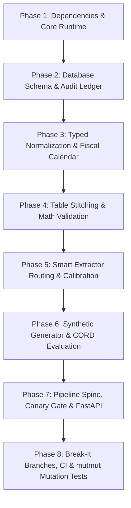

# Ledgerline - Part 1: Project Setup & Technical Architecture Roadmap

This document captures the initial setup, specifications, and architecture roadmap established during the project inception chat.

---

## 1. Initial File & Directory Structure

The initial repository structure was created with zero code (empty files and folders) as requested:

```
ledgerline/
├── app/
│   ├── api/
│   │   ├── auth.py
│   │   ├── middleware.py
│   │   └── router.py
│   ├── calibration/
│   │   ├── ece.py
│   │   ├── features.py
│   │   └── fit.py
│   ├── core/
│   │   ├── config.py
│   │   ├── logging.py
│   │   ├── request_id.py
│   │   └── sentry.py
│   ├── db/
│   │   ├── migrations/
│   │   └── session.py
│   ├── extract/
│   │   ├── llm_adapter.py
│   │   ├── native.py
│   │   ├── ocr.py
│   │   ├── router.py
│   │   └── stitch.py
│   ├── pipeline/
│   │   ├── batch.py
│   │   ├── canary.py
│   │   └── ledger.py
│   ├── prompts/
│   │   └── v1/
│   │       ├── fewshot.json
│   │       └── system.txt
│   ├── queue/
│   │   ├── leases.py
│   │   └── reaper.py
│   ├── scoring/
│   │   ├── comparators.py
│   │   └── metrics.py
│   ├── timefiscal/
│   │   ├── fiscal.py
│   │   └── tz.py
│   └── validate/
│       ├── errors.py
│       └── math.py
├── scripts/
│   ├── backfill.py
│   ├── load_cord.py
│   └── make_invoices.py
├── tests/
├── .github/
│   └── workflows/
│       ├── batch.yml
│       ├── breakit.yml
│       └── ci.yml
├── pyproject.toml
└── README.md
```

---

## 2. System Overview & Tech Stack

Ledgerline is an automated pipeline for invoice and receipt extraction, prioritizing mathematically validated data, calibrated confidence routing, and strict auditability.

- **Database**: PostgreSQL (hosted on Neon). No vector databases.
- **Storage**: Cloudflare R2 for raw PDF and image storage.
- **Backend**: FastAPI with API key auth, request IDs, Sentry integration, and structured JSON logs.
- **Data Processing & Extraction**:
  - Pydantic for structured outputs.
  - `pdfplumber` for native digital PDFs.
  - Tesseract OCR for scanned documents.
  - LLM adapter with versioned prompts.
- **Infrastructure**:
  - GitHub Actions for scheduled batch pipeline execution.
  - Render (thin free tier) for the live app.
  - Cloudflare Pages for static JSON demo samples.

---

## 3. Database Schema Requirements

The PostgreSQL schema is designed for isolation, audit trails, and concurrency:

1. **Core Entities**: `documents`, `pages`, `fields`, `field_features`.
2. **`extraction_versions`**: Append-only table containing `valid_from` and `valid_to` columns to support time-travel `as_of` queries.
3. **`review_items`**: Implements row-level leases using `SELECT FOR UPDATE SKIP LOCKED` and optimistic concurrency (returns HTTP 409 status with a field-level diff on collision).
4. **Pipeline Spine**: `run_ledger` and `dead_letter` tables.
5. **`cost_meter`**: Logs compute/token cost and the routing path of every call.

---

## 4. The 8 Technical Directives ("Arts")

### 1. Multi-Page Table Stitching & Validation
- **Logic**: Cluster the x-intervals of cell boundaries per page to carry column alignments forward across page breaks. Fingerprint page headers by hashing normalized tokens to drop repeated headers.
- **Validation**: Calculate $\sum(\text{quantity} \times \text{unit\_price}) \equiv \text{subtotal} \pm 1\text{ currency unit}$.
- **Action**: If math fails, raise a typed validation error and route to `dead_letter` (park the document). Do not write a row to the clean table. Park rate target must be $< 3\%$.

### 2. Calibration & Review Routing
- **Logic**: Do not trust raw LLM token probabilities. Fit an isotonic regression calibrator using Platt scaling as the baseline.
- **Signals**: Use OCR character confidence (if available), token probability, layout features, validation outcomes, and conditional two-pass agreement.
- **Constraint**: Fit the calibrator while completely holding out one specific layout and one vendor. Measure Expected Calibration Error (ECE) out-of-distribution using 10 equal-mass bins (Target: $\text{ECE} \le 0.10$).

### 3. Typed Scoring & Normalization
- **Logic**: Use typed comparators for evaluation, avoiding naive string matching.
- **Types**:
  - **Money**: Decimal + currency code.
  - **Dates**: Explicit locale rules; record genuine ambiguity instead of guessing.
  - **Strings**: Normalize whitespace, case, and legal entity suffixes (e.g., `"Ltd"`).

### 4. Timezone & Fiscal Correctness
- **Logic**: Store dates as an absolute instant (UTC) plus the source timezone. Assign reporting periods using a hardcoded fiscal calendar.
- **Tests**: Explicit tests for daylight saving boundaries, leap days (Feb 29), cross-timezone identical period resolution, and year-boundary totals.

### 5. Idempotency & Append-Only History
- **Logic**: Uploading the same file twice must be a strict no-op.
- **Idempotency Key**: $\text{hash}(\text{file\_content}) + \text{extractor\_version}$.
- **Cache**: Page-level caching keyed on `page_hash`, `extractor_version`, and `prompt_version` (must prove a re-run of a batch makes exactly zero LLM network calls).

### 6. Queue Concurrency & Zero-Downtime Migrations
- **Queue**: Background reaper process to release expired document leases.
- **Migration**: Chunked, resumable schema backfill with a progress table, tested rollback, and zero downtime budget.

### 7. Cost Ceiling via Smart Routing
- **Logic**: Classify native text vs. scanned pages.
  - Route native pages to cheap path (text + layout coordinates + text-only model).
  - Route scanned pages (or low-confidence critical fields) to expensive Vision model path.
- **Optimization**: Cache static Pydantic schemas and few-shot prompt blocks.

### 8. Pipeline Spine & Quality Gate
- **Logic**: Scheduled batch pipeline processing a drop folder with a watermark and run ledger.
- **Canary Gate**: Run a 50-document canary slice first; fail the entire run and fire an alert if field $F_1$ drops by more than 2 points against the rolling baseline.
- **CI Test Suite**: Ingest a zero-byte file, a password-locked PDF, a 400-page doc, and an invoice with corrupted math to verify the batch fails cleanly and writes nothing to clean tables.

---

## 5. Evaluation Datasets

1. **CORD Dataset (1,000 real receipt photos)**:
   - Rule: CORD does not label vendors or dates, so only score line items, subtotals, tax, and totals on this set.
   - Never blend this score with the synthetic score.
2. **Synthetic Generator (`scripts/make_invoices.py`)**:
   - Uses `reportlab` and `Faker` to generate 8 layouts with multi-page boundary overlaps and visual degradation (skew, shadow, noise, 150 DPI).
   - Vendor and Date accuracy are scored exclusively on this dataset.

---

## 6. Mandatory Testing & CI Gates

1. **Break-It Branches**:
   - Implement a 1-line deliberate fault in code for:
     - Multi-page stitching
     - Calibration
     - Idempotency
     - Canary quality gate
   - CI pipeline must run these branches and assert that the corresponding test fails (goes red).
2. **Mutation Testing**:
   - `mutmut` configuration requiring $\ge 80\%$ mutants killed on core hard-part modules.

---

## 7. Architecture Implementation Plan


